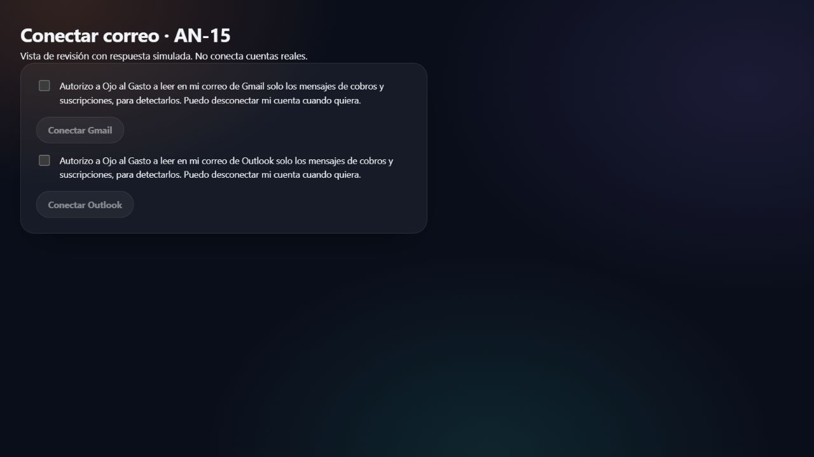
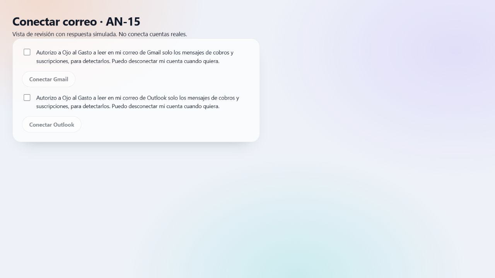

# AN-15: comprobación visual, 22 de octubre de 2026

Componente real `ConectarCorreo`, tokens de tema y `Boton` compartido, mostrado
en una página temporal local. Ambos proveedores comienzan sin consentimiento y
sus botones deshabilitados. El backend del montaje es un doble que rechaza la
petición: estas capturas no acreditan conexión OAuth ni montaje en CH-23.

