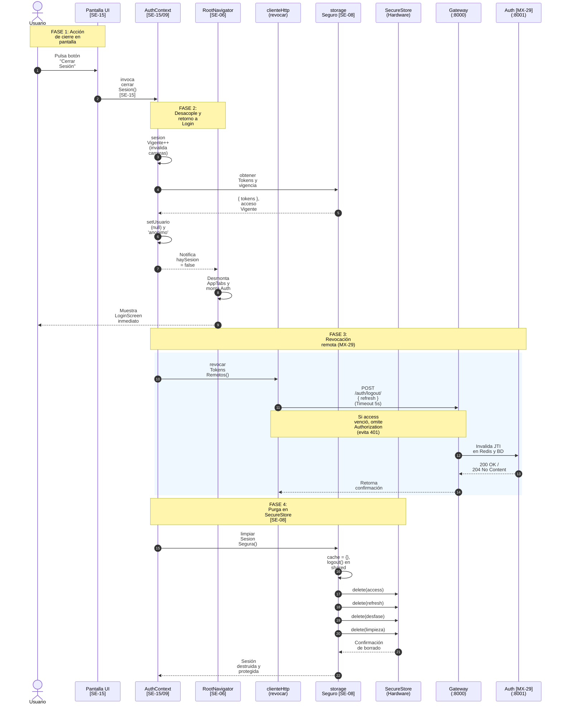

# Flujo de Cierre de Sesión Móvil (Especificación Técnica Detallada)

Este documento detalla con **máxima precisión técnica y conceptual** el recorrido completo del **cierre de sesión y limpieza de datos privados en la aplicación móvil**:  
`Usuario pulsa salir` ➔ `Invalida peticiones en vuelo (Carreras)` ➔ `Cierre síncrono en memoria y conmutación de estado` ➔ `Desmontaje físico de navegación privada` ➔ `Revocación remota en Gateway/Auth (MX-29)` ➔ `Limpieza atómica en hardware SecureStore (SE-08)` ➔ `Muestra pantalla de Login`.

---

## 🗺️ Mapa de Trazabilidad por Historias / Tareas

| Código | Tarea / Componente | Responsable | Responsabilidad en este flujo |
|---|---|---|---|
| **SE-15** | Cerrar sesión y limpiar datos privados en móvil | Sebastian Mena | Orquestación completa de cierre en `AuthContext.tsx`, acción visible en UI, desmontaje de rutas y control de fallos. |
| **SE-08** | Almacenamiento seguro móvil | Sebastian Mena | `storageSeguro.ts`: vaciado de `cacheMemoria`, `logout()` en shared, eliminación en `expo-secure-store` y marca durable `limpieza_pendiente`. |
| **SE-06** | Navegación Condicional | Sebastian Mena | `RootNavigator.tsx`: detecta `haySesion === false`, desmonta `AppTabNavigator` y monta de forma atómica `AuthNavigator`. |
| **SE-07** | Retorno al Stack Público | Sebastian Mena | `LoginScreen.tsx`: pantalla a la que queda confinado el usuario sin historial de retorno al pulsar botón "Atrás". |
| **MX-29** | Revocación de sesión en backend | Maximiliano Sáez | Endpoint `POST /api/auth/logout/`: revoca el `refresh_token` en Redis/BD y el Gateway rechaza la sesión en ≤ 60 seg. |

---

## 🧭 Resumen de Funciones Relevantes y Puntos de Entrada de Datos

| Etapa | Archivo / Capa | Función / Componente Relevante | Dónde y qué datos recibe | Qué hace / Por qué es relevante |
| :--- | :--- | :--- | :--- | :--- |
| **1. UI Trigger** | `ConfiguracionScreen.tsx` / `HomeScreen.tsx` | `<NavButton testID="logout" onPress={cerrarSesion} />` | Evento táctil `onPress` del usuario. | Dispara la acción visible de salida con variante visual de peligro (`variant="danger"`). |
| **2. Orquestador** | `AuthContext.tsx` | `cerrarSesion()` | Hook `useAuth()` sin argumentos. | Incrementa `sesionVigente`, captura credenciales antes de borrar y conmuta la UI a `'anonimo'`. |
| **3. UI Unmount** | `RootNavigator.tsx` | Condicional en `<Stack.Navigator>` | Lee `haySesion: boolean` desde `AuthContext`. | Cuando pasa a `false`, destruye físicamente de la memoria las pantallas privadas y monta `AuthNavigator`. |
| **4. Red Remota** | `clienteHttp.ts` | `revocarTokensRemotos(credenciales, accesoVigente)` | Recibe `{ refresh_token, access_token }` y un booleano de vigencia. | Envía `POST /api/auth/logout/` con timeout de 5s; no bloquea si falla el internet o el servidor. |
| **5. Purga Hardware**| `storageSeguro.ts` | `limpiarSesionSegura()` | No recibe datos (opera sobre el almacenamiento interno). | Vacia `cacheMemoria = {}`, purga tokens compartidos y elimina físicamente las claves en el chip seguro. |
| **6. Backend Auth** | Gateway / Servicio Auth | `POST /api/auth/logout/` (MX-29) | Recibe JSON `{ refresh_token }` y header opcional `Authorization`. | Registra revocación en Redis, destruye sesión en BD y propaga el bloqueo al API Gateway. |

---

## 🔄 Diagrama de Secuencia



---

## 💡 Fichas Rápidas: ¿Qué hace cada función en palabras simples?

Esta sección explica de forma clara y directa qué hace cada función y componente que participa en el cierre de sesión:

### 1. Botón "Cerrar Sesión" (`<NavButton testID="logout" />`)
* **Dónde está:** `frontend/movil/src/screens/configuracion/ConfiguracionScreen.tsx` y `HomeScreen.tsx`
* **Qué hace en simple:** Es el botón rojo que toca el usuario cuando quiere salir de su cuenta.
* **📥 ¿Qué recibe?:** El toque físico en la pantalla (`onPress`).
* **📤 ¿Qué entrega?:** Llama directamente a la función `cerrarSesion()` del contexto de la app.
* **🎯 Por qué importa:** Ofrece un punto visible, claro y seguro para que el usuario decida salir cuando quiera.

---

### 2. `cerrarSesion()` (El director de orquesta del cierre de sesión)
* **Dónde está:** `frontend/movil/context/AuthContext.tsx`
* **Qué hace en simple:** Es el cerebro que coordina todo el cierre. Primero sube los números de versión para ignorar cualquier petición vieja que viniera viajando; toma una foto rápida de los tokens; cambia el semáforo de la app a `'anonimo'` para expulsar al usuario a la pantalla de Login de inmediato; manda a avisar al servidor por internet y finalmente destruye las llaves en el chip del teléfono.
* **📥 ¿Qué recibe?:** No recibe parámetros.
* **📤 ¿Qué envía y a dónde?:**
  1. Conmuta `setEstado('anonimo')` y `setUsuario(null)`.
  2. Dispara `revocarTokensRemotos()` en segundo plano hacia el Gateway.
  3. Ejecuta `limpiarSesionSegura()` para purgar el almacenamiento físico.
* **🎯 Por qué importa:** Garantiza que el cierre sea instantáneo para el usuario sin importar si el internet está lento o caído.

---

### 3. `obtenerTokensSeguros()` (La foto instantánea antes de borrar)
* **Dónde está:** `frontend/movil/src/services/storageSeguro.ts`
* **Qué hace en simple:** Toma una copia rápida de los tokens que están en la memoria RAM justo un milisegundo antes de que los borremos.
* **📥 ¿Qué recibe?:** No recibe parámetros; lee de la RAM interna.
* **📤 ¿Qué entrega?:** Devuelve `{ access_token, refresh_token }`.
* **🎯 Por qué importa:** Si borráramos la memoria primero, la app no sabría cuál `refresh_token` enviar al backend para anularlo.

---

### 4. `<RootNavigator />` (El desmontador físico de pantallas privadas)
* **Dónde está:** `frontend/movil/src/navigation/RootNavigator.tsx`
* **Qué hace en simple:** Detecta que la sesión murió (`haySesion === false`), borra de golpe de la memoria del teléfono todas las pestañas privadas (`Home`, `Panel`, `Configuración`) y te planta en la pantalla de `Login`.
* **📥 ¿Qué recibe?:** Lee la variable booleana `haySesion`.
* **📤 ¿Qué entrega?:** Reemplaza el árbol de componentes privados por `<AuthNavigator>`.
* **🎯 Por qué importa:** Destruye cualquier dato privado que hubiera quedado en pantalla y hace que sea imposible volver atrás apretando el botón físico "Atrás" de Android.

---

### 5. `revocarTokensRemotos(credenciales, accesoVigente)` (El mensajero hacia el servidor)
* **Dónde está:** `frontend/movil/src/services/clienteHttp.ts`
* **Qué hace en simple:** Prepara una carta para el servidor diciendo: *"anula este refresh_token"*. Si el token de acceso ya estaba vencido, tiene la astucia de no adjuntarlo para que Django no rechace la carta con un error 401. Tiene un temporizador de 5 segundos; si no hay internet o el servidor no contesta, se rinde en silencio sin molestar al usuario.
* **📥 ¿Qué recibe?:** Las credenciales capturadas `{ refresh_token, access_token }` y si el acceso aún no caduca (`accesoVigente`).
* **📤 ¿Qué envía y a dónde?:** Envía una petición `POST /api/auth/logout/` hacia el API Gateway.
* **🎯 Por qué importa:** Invalida el pase en la nube para que nadie pueda usar esa misma sesión desde otro dispositivo o clonando el token.

---

### 6. `limpiarSesionSegura()` (El triturador del chip seguro)
* **Dónde está:** `frontend/movil/src/services/storageSeguro.ts`
* **Qué hace en simple:** Abre la caja fuerte criptográfica del teléfono (`SecureStore`) y borra físicamente las llaves (`access_token`, `refresh_token`, etc.). Además deja la memoria RAM en blanco (`{}`).
* **📥 ¿Qué recibe?:** No recibe parámetros.
* **📤 ¿Qué entrega?:** Borra las claves con `deleteItemAsync` en el hardware del teléfono.
* **🎯 Por qué importa:** Asegura que si alguien te roba el teléfono apagado o lo reinicia, la app despierte totalmente cerrada y requiera clave.

---

### 7. `logout()` (El limpiador de la librería compartida)
* **Dónde está:** `frontend/shared/src/auth.ts`
* **Qué hace en simple:** Le avisa al cliente HTTP general que el token ya no existe para que futuras peticiones no intenten adjuntar llaves fantasmas.
* **📥 ¿Qué recibe?:** No recibe parámetros.
* **📤 ¿Qué entrega?:** Llama al método `removeItem` del storage compartido.
* **🎯 Por qué importa:** Mantiene sincronizado el cliente HTTP de la app con el estado real de la sesión.

---

### 8. Endpoint `POST /api/auth/logout/` (El guardia del Backend - MX-29)
* **Dónde está:** Backend Django / API Gateway
* **Qué hace en simple:** Recibe el `refresh_token` que mandó el teléfono, busca la sesión en la base de datos y la anota en una lista negra de alta velocidad en Redis.
* **📥 ¿Qué recibe?:** El JSON `{ refresh_token: "..." }`.
* **📤 ¿Qué entrega?:** Un código `200 OK` confirmando que la sesión quedó anulada.
* **🎯 Por qué importa:** Hace que el Gateway rechace cualquier intento posterior de usar esa sesión en menos de 60 segundos.

---

## 🔎 Recorrido Detallado Paso a Paso con Código Relevante

---

### Paso 1: Acción Visible en la Interfaz de Usuario
* **Archivos:**  
  - [`frontend/movil/src/screens/configuracion/ConfiguracionScreen.tsx`](file:///home/sebamena/Documentos/GitHub/integra-lll/frontend/movil/src/screens/configuracion/ConfiguracionScreen.tsx#L48-L56)
  - [`frontend/movil/src/screens/home/HomeScreen.tsx`](file:///home/sebamena/Documentos/GitHub/integra-lll/frontend/movil/src/screens/home/HomeScreen.tsx#L29-L34)

#### 💡 ¿Qué hace en simples palabras?
Muestra un botón rojo bien visible de "Cerrar Sesión" en la pantalla de Configuración y en el Home. Cuando el usuario lo toca con el dedo, dispara la orden de salida llamando directamente a la función `cerrarSesion()`.

#### ¿Dónde y qué datos se reciben?
El componente consume la función `cerrarSesion` expuesta por el hook `useAuth()`. Cuando el usuario presiona el botón, se dispara el evento `onPress`.

#### Código Relevante:
```tsx
// frontend/movil/src/screens/configuracion/ConfiguracionScreen.tsx (Líneas 48-56)
<View style={styles.seccion}>
  <Text style={styles.tituloSeccion}>Sesión</Text>
  <NavButton
    testID="logout"
    title="Cerrar Sesión"
    variant="danger"
    onPress={() => void cerrarSesion()}
  />
</View>
```

---

### Paso 2: Orquestación del Cierre e Invalidación de Carreras (*Race Conditions*)
* **Archivo:** [`frontend/movil/context/AuthContext.tsx`](file:///home/sebamena/Documentos/GitHub/integra-lll/frontend/movil/context/AuthContext.tsx#L223-L245)
* **Función:** `cerrarSesion()`

#### 💡 ¿Qué hace en simples palabras?
Es el centro de control del cierre. Primero sube los números de versión para ignorar cualquier respuesta de red vieja que viniera llegando tarde. Luego saca una foto rápida de los tokens en memoria antes de borrarlos, cambia la luz de la app a `'anonimo'` para expulsar al usuario al instante a la pantalla de Login, manda un mensaje al servidor en segundo plano y ordena vaciar la caja fuerte del teléfono.

#### ¿Dónde y qué datos se reciben?
No recibe parámetros. Obtiene una instantánea (*snapshot*) de los tokens activos (`access_token` y `refresh_token`) y el estado de vigencia del token de acceso (`haySesionValida()`) **antes** de limpiar la memoria.

#### ¿Qué hace y por qué es relevante?
1. **Invalida peticiones en vuelo:** Al incrementar `sesionVigente.current++` y `ultimaPeticion.current++`, cualquier petición lenta de red (como `cargarPerfil`) que termine milisegundos después del logout será descartada y no volverá a inyectar al usuario.
2. **Cierre inmediato de UI:** Cambia el estado a `'anonimo'` antes de esperar a la red o al disco para ofrecer una respuesta táctil instantánea.
3. **Disparo aislado de red:** Envía la revocación remota sin bloquear el hilo principal.
4. **Purga local persistente:** Invoca `limpiarSesionSegura()` para destruir las claves en hardware.

#### Código Relevante:
```tsx
// frontend/movil/context/AuthContext.tsx (Líneas 223-245)
const cerrarSesion = useCallback(async () => {
  // 1. Invalida inmediatamente cualquier petición asíncrona en vuelo
  sesionVigente.current++;
  ultimaPeticion.current++;

  // 2. Capturar credenciales activas y vigencia del access token antes de limpiar memoria
  const credenciales = obtenerTokensSeguros();
  const accesoVigente = haySesionValida();

  // 3. Cierre inmediato en memoria para navegación pública instantánea
  setUsuario(null);
  setEstado('anonimo');
  setEstadoPerfil('inactivo');
  setErrorPerfil(null);

  // 4. Revocación remota aislada en segundo plano con las credenciales capturadas y vigencia
  if (credenciales.refresh_token) {
    void revocarTokensRemotos(credenciales, accesoVigente);
  }

  // 5. Limpieza persistente en hardware seguro: se ejecuta inmediatamente
  await limpiarSesionSegura();
}, []);
```

---

### Paso 3: Destrucción de la Navegación Privada y Confinamiento en Login
* **Archivo:** [`frontend/movil/src/navigation/RootNavigator.tsx`](file:///home/sebamena/Documentos/GitHub/integra-lll/frontend/movil/src/navigation/RootNavigator.tsx#L23-L31)

#### 💡 ¿Qué hace en simples palabras?
Apenas la app detecta que ya no hay sesión (`haySesion === false`), borra de golpe de la memoria del teléfono todas las pantallas privadas (Home, Panel, Calendario, Configuración) y monta la pantalla de Login. Como las pantallas privadas fueron eliminadas físicamente, si el usuario presiona el botón físico "Atrás" de Android no puede regresar a ver sus datos.

#### ¿Dónde y qué datos se reciben?
`RootNavigator` re-renderiza automáticamente al detectar que `haySesion` cambió de `true` a `false`.

#### ¿Por qué es relevante para la seguridad?
React Navigation desmonta físicamente del Virtual DOM todo el árbol de pantallas privadas (`AppTabNavigator`: Home, Panel, Calendario, Configuración, Perfil).  
* **Sin botón Atrás:** Si el usuario pulsa la flecha o gesto de "Atrás" de Android, el sistema operativo no vuelve a la pantalla privada porque ya no existe en la pila de navegación.
* **Sin fuga de datos:** Al desmontar los componentes, sus estados locales y formularios se destruyen de la memoria RAM del teléfono.

#### Código Relevante:
```tsx
// frontend/movil/src/navigation/RootNavigator.tsx (Líneas 23-31)
return (
  <Stack.Navigator screenOptions={{ headerShown: false }}>
    {!haySesion ? (
      <Stack.Screen name="Auth" component={AuthNavigator} />
    ) : (
      <Stack.Screen name="App" component={AppTabNavigator} />
    )}
  </Stack.Navigator>
);
```

---

### Paso 4: Revocación Remota en el Servidor (SE-15 ➔ MX-29)
* **Archivo:** [`frontend/movil/src/services/clienteHttp.ts`](file:///home/sebamena/Documentos/GitHub/integra-lll/frontend/movil/src/services/clienteHttp.ts#L280-L322)
* **Función:** `revocarTokensRemotos(credenciales, accesoVigente)`

#### 💡 ¿Qué hace en simples palabras?
Envía un paquete HTTP por internet hacia el servidor diciendo: *"anula este refresh_token"*. Si el token de acceso ya llevaba más de media hora vencido, no lo adjunta para evitar que el servidor rechace la petición con un error 401 antes de tiempo. Si no hay internet o el servidor tarda más de 5 segundos, se rinde en silencio: lo más importante es que el usuario ya salió en su teléfono y no queda atrapado.

#### ¿Dónde y qué datos se reciben?
Recibe las credenciales capturadas en el Paso 2: `{ refresh_token, access_token }` y la bandera `accesoVigente`.

#### ¿Qué problema crítico resuelve esta función?
1. **Regla de Django REST Framework (DRF):** Si una sesión lleva más de 30 minutos abierta, el `access_token` ya expiró. Si la app enviase `Authorization: Bearer <expirado>`, DRF respondería `401 Unauthorized` antes de leer el cuerpo, dejando el `refresh_token` sin revocar en la base de datos.
   - Solución: Si `accesoVigente === false`, la función **omite el header `Authorization`** y envía únicamente `{ refresh_token }` en el cuerpo JSON.
2. **Tolerancia a desconexión (Offline):** Utiliza un `AbortController` con timeout de 5 segundos. Si el usuario no tiene señal o el servidor está caído, la función atrapa el error (`try/catch`), retorna `false` y **no interrumpe el cierre local**. El usuario jamás queda atrapado en su cuenta por falta de internet.

#### Código Relevante:
```tsx
// frontend/movil/src/services/clienteHttp.ts (Líneas 280-322)
export async function revocarTokensRemotos(
  credenciales?: {
    access_token?: string | null;
    refresh_token?: string | null;
  } | null,
  accesoVigente: boolean = false
): Promise<boolean> {
  const refreshToken = credenciales?.refresh_token;
  if (!refreshToken) return false;

  const urlBase = obtenerUrlBaseConfigurada();
  const urlLogout = `${urlBase}/auth/logout/`;

  const controller = typeof AbortController !== 'undefined' ? new AbortController() : null;
  const timeoutId = controller ? setTimeout(() => controller.abort(), 5000) : null;

  try {
    const headers: Record<string, string> = {
      'Content-Type': 'application/json',
    };
    // Solo incluye Authorization si el access token NO ha expirado
    if (accesoVigente && credenciales?.access_token) {
      headers['Authorization'] = `Bearer ${credenciales.access_token}`;
    }

    const respuesta = await fetch(urlLogout, {
      method: 'POST',
      headers,
      body: JSON.stringify({ refresh_token: refreshToken }),
      signal: controller?.signal,
    });

    return respuesta.ok;
  } catch (_error) {
    // La revocación remota es tolerante a fallos de red/servidor
    return false;
  } finally {
    if (timeoutId) clearTimeout(timeoutId);
  }
}
```

---

### Paso 5: Purga Atómica en Almacenamiento Seguro (Hardware)
* **Archivo:** [`frontend/movil/src/services/storageSeguro.ts`](file:///home/sebamena/Documentos/GitHub/integra-lll/frontend/movil/src/services/storageSeguro.ts#L362-L394)
* **Función:** `limpiarSesionSegura()`

#### 💡 ¿Qué hace en simples palabras?
Abre la caja fuerte criptográfica del teléfono (`SecureStore`) y destruye físicamente las llaves guardadas (`access_token`, `refresh_token` y `desfase_reloj_ms`). Además borra la memoria RAM. Así se asegura de que si apagas el teléfono o cierras la app, nadie pueda entrar sin escribir la contraseña de nuevo.

#### ¿Dónde y qué datos se reciben?
No recibe parámetros. Elimina todas las entradas asociadas a la sesión actual.

#### ¿Por qué es relevante para la seguridad física?
Garantiza que nadie pueda recuperar la sesión al volver a abrir la aplicación:
1. **Memoria síncrona:** Vacia `cacheMemoria = {}` e invoca `logout()` de `@ojoalgasto/shared`.
2. **Generación de borrado:** Incrementa `generacionActual++` para cancelar cualquier guardado asíncrono obsoleto que estuviera en cola.
3. **Hardware Keystore / Keyring:** Solicita a `expo-secure-store` la eliminación criptográfica de:
   - `access_token`
   - `refresh_token`
   - `desfase_reloj_ms`
   - `limpieza_pendiente`
4. **Política Durable (Protección ante cierres forzados):** Si el sistema operativo cerrara el proceso abruptamente durante la escritura, al volver a abrir la app, la función de arranque (`hidratarSesionSegura`) detecta residuos y purga cualquier dato restante.

#### Código Relevante:
```tsx
// frontend/movil/src/services/storageSeguro.ts (Líneas 362-394)
export async function limpiarSesionSegura(): Promise<void> {
  if (!storageInicializado) inicializarStorageSeguro();

  sesionEnLimpieza = true;
  const gen = ++generacionActual;
  promesasPorGeneracion.set(gen, []);

  try {
    // 1. Limpieza inmediata e incondicional en memoria síncrona
    cacheMemoria = {};
    logout();

    // 2. Borrado explícito de marca de limpieza previa
    encolarDelete(CLAVES_SEGURAS.LIMPIEZA_PENDIENTE, gen);

    // 3. Esperar a que se completen todos los borrados de esta generación
    const promesas = promesasPorGeneracion.get(gen) ?? [];
    await Promise.all(promesas);
  } catch (err) {
    throw new Error(`Fallo al limpiar sesión en almacenamiento seguro: ${err}`);
  } finally {
    sesionEnLimpieza = false;
    promesasPorGeneracion.delete(gen);
  }
}
```

---

### Paso 6: Comportamiento Esperado en Backend y Gateway (Contrato MX-29)

#### 💡 ¿Qué hace en simples palabras?
En el servidor, el Gateway y Auth reciben el aviso de cierre, marcan la sesión como revocada en la base de datos y anotan el identificador único del token en una lista negra de alta velocidad en Redis. Así, cualquier intento futuro de usar ese token desde cualquier parte del mundo será bloqueado en menos de 60 segundos.

Aunque el PR final de backend (**MX-29**, a cargo de Maximiliano Sáez) concluya su revisión, el contrato acordado en la arquitectura fija el siguiente comportamiento del lado servidor:

1. **Endpoint `POST /api/auth/logout/`:**
   - Recibe `{ refresh_token }`.
   - Localiza la sesión correspondiente en la base de datos y la marca con `revocada = True` y `fecha_revocacion = now()`.
   - Registra el identificador único del token (`jti`) en una lista de bloqueo (*blacklist*) en **Redis** con un tiempo de vida (**TTL**) equivalente al tiempo restante del token.
2. **Ventana de 60 Segundos en el Gateway:**
   - El requisito de seguridad exige que cualquier petición posterior con un token de esa sesión sea rechazada por el Gateway en **menos de 60 segundos** (tiempo de propagación de la caché de revocaciones).
3. **Coordinación con Refresh (MX-10):**
   - Una vez revocado el `refresh_token`, cualquier intento posterior de usarlo en `POST /api/auth/refresh/` responderá `401 Unauthorized` e invalidará toda la familia de tokens por detección de reutilización fraudulenta.

---

## 💡 Explicación Simple (¿Qué envía a qué lado y para qué sirve?)

Imagina que tu teléfono es una oficina y la sesión es una tarjeta de identificación:

1. **El usuario presiona "Cerrar Sesión":**
   - El recepcionista (`AuthContext`) rompe de inmediato la tarjeta en memoria (`setEstado('anonimo')`).
   - Apaga las luces de las salas privadas (desmonta la navegación privada) y te lleva de inmediato a la entrada principal del edificio (`LoginScreen`).
2. **Aviso a la central de seguridad (`revocarTokensRemotos` hacia el Backend):**
   - El recepcionista le manda un mensaje por radio a la central (`POST /api/auth/logout/`): *"La tarjeta con número de serie X ha sido anulada"*.
   - La central (Redis/Gateway) la anota en la lista negra. Si alguien robó esa tarjeta o intentara usarla en otra computadora, la puerta no se abrirá.
   - Si no hay señal de radio (sin internet), el recepcionista no se detiene ni te retiene en la oficina: te saca a la entrada de todos modos.
3. **Trituración en la caja fuerte (`limpiarSesionSegura` en Hardware):**
   - El recepcionista abre la caja fuerte de titanio del teléfono (`Expo SecureStore`) y borra cualquier copia de la llave para que, si apagas y vuelves a encender el celular, nadie pueda entrar sin escribir su usuario y clave de nuevo.

---

## 📚 Glosario de Términos Informáticos

* **Revocación de Token:** Acción de invalidar un token criptográfico antes de su fecha natural de expiración, impidiendo que siga otorgando acceso a recursos protegidos.
* **Idempotencia:** Propiedad de una operación que produce exactamente el mismo resultado final sin importar cuántas veces consecutivas se ejecute (ejemplo: pulsar "Cerrar Sesión" 3 veces seguidas no rompe el sistema).
* **Condición de Carrera (*Race Condition*):** Error que ocurre cuando dos procesos asíncronos compiten por el mismo recurso y el resultado depende de cuál termina primero. En la app se evita mediante números de generación (`sesionVigente++`).
* **Desmontaje del DOM Virtual / Árbol de Navegación:** Mecanismo de React por el cual un componente y todos sus hijos son eliminados completamente de la memoria y de la pantalla, destruyendo sus variables de estado.
* **Hardware Keystore / Keyring:** Área de almacenamiento encriptada y protegida a nivel de procesador/hardware en el teléfono (Android Keystore en Android y Apple Keychain en iOS).
* **AbortController:** Objeto estándar de JavaScript que permite cancelar una petición HTTP si se agota un tiempo límite (*timeout*), evitando que la app quede congelada esperando al servidor.
* **JTI (*JWT ID*):** Identificador único y no repetible que se incluye dentro del payload de un token JWT para distinguir una emisión de otra y poder bloquearla en listas negras.
* **Blacklist en Memoria (Redis):** Lista de tokens revocados almacenada en memoria ultrarrápida (Redis) en el servidor, consultada por el Gateway para bloquear peticiones en microsegundos sin sobrecargar la base de datos principal.
* **Stack Público vs. Stack Privado:** Estructuras de navegación separadas: el stack público agrupa pantallas abiertas (Login, Registro), mientras que el privado contiene las pantallas restringidas (Home, Perfil, Configuración).
* **Tolerancia a Desconexión (*Offline-First Resilience*):** Capacidad de la aplicación de completar acciones críticas para el usuario (como salir de su cuenta) incluso cuando no existe conexión a internet.
