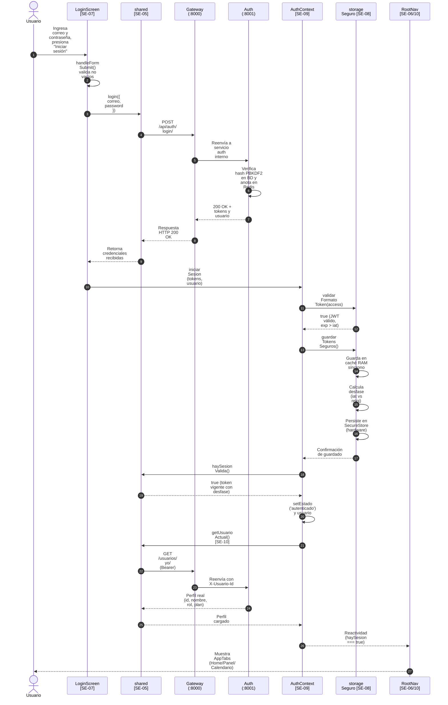

# Flujo de Inicio de Sesión Móvil (Especificación Técnica Detallada)

Este documento detalla con **máxima precisión técnica y pedagógica** el recorrido completo del inicio de sesión en la aplicación móvil:
`Formulario Móvil` ➔ `Cliente Compartido` ➔ `Backend Auth Valida` ➔ `Devuelve Tokens` ➔ `App Consulta Perfil y Abre Navegación Privada`.

Incluye un **glosario informático exhaustivo** y **fichas simples** que explican en lenguaje directo qué hace cada función, qué recibe y a dónde envía los datos.

---

## 📚 Glosario de Términos Informáticos

Para entender este flujo sin perderse en tecnicismos, aquí tienes la explicación clara de cada concepto aplicado a este proyecto:

### 1. Criptografía y Seguridad
* **JWT (JSON Web Token):** Estándar abierto ([RFC 7519](https://datatracker.ietf.org/doc/html/rfc7519)) para transmitir información de identidad firmada digitalmente en formato JSON. Se divide en tres partes separadas por puntos: `Header.Payload.Signature`.
* **Claims (Reclamaciones o Atributos):** Datos encapsulados dentro del Payload de un JWT:
  * **`iat` (*Issued At*):** Marca temporal (timestamp en segundos) del servidor al momento exacto en que emitió el token.
  * **`exp` (*Expiration Time*):** Timestamp exacto en el que el token caduca automáticamente.
  * **`user_id` / `sub` (*Subject*):** Identificador primario del usuario en la base de datos PostgreSQL.
  * **`session_version`:** Hash único que se valida contra Redis para permitir revocar sesiones antes de su expiración natural.
* **Función Hash Criptográfica:** Función matemática unidireccional (irreversible) que transforma cualquier texto (como una contraseña) en una cadena alfanumérica de longitud fija. No se puede "descifrar"; solo se puede comparar si una contraseña nueva produce el mismo hash.
* **Sal (*Salt*):** Cadena aleatoria única que se concatena a la contraseña antes de aplicar el hash para que dos usuarios con la misma contraseña tengan hashes completamente diferentes en la base de datos. Evita ataques mediante *Tablas Rainbow* (diccionarios de hashes precalculados).
* **PBKDF2 (*Password-Based Key Derivation Function 2*):** Algoritmo estándar del NIST que aplica miles de iteraciones de hashing (en este proyecto, 100.000 rondas) sobre la contraseña y la sal para volver extremadamente lentos los ataques de fuerza bruta.
* **HMAC-SHA256:** Mecanismo de firma criptográfica que combina una función hash segura (SHA-256) con una clave secreta (`JWT_SECRET`) para verificar que el token no haya sido alterado por un tercero.
* **Bearer Token:** Esquema de autenticación HTTP (*"al portador"*). Quien posea el token en la cabecera `Authorization: Bearer <token>` tiene autorización para consultar los recursos protegidos.
* **Access Token vs. Refresh Token:**
  * **Access Token:** Credencial de corta vida (**30 minutos**) que viaja en cada petición protegida.
  * **Refresh Token:** Credencial de larga vida (**7 días**) que no se usa para consultar recursos, sino exclusivamente para solicitar un nuevo Access Token cuando el anterior vence.
* **Almacenamiento Seguro en Hardware (*SecureStore*):** Mecanismo de persistencia nativa que cifra los datos mediante chips criptográficos del dispositivo: **Android Keystore** en Android y **iOS Keychain** en Apple. Es invulnerable a lecturas simples si el teléfono es rooteado o conectado por USB.

### 2. Concurrencia y Sistemas Operativos
* **Memoria RAM (Caché síncrona) vs. Persistencia en Hardware:**
  * La **RAM** es volátil y ultrarrápida: se lee instantáneamente de forma síncrona en nanosegundos, pero se borra al cerrar la app.
  * El **Hardware (`SecureStore`)** es persistente pero lento: requiere operaciones de I/O asíncronas hacia el chip criptográfico.
* **Síncrono vs. Asíncrono:**
  * **Síncrono:** Bloquea la ejecución del hilo principal hasta que la instrucción termina.
  * **Asíncrono:** Se ejecuta en segundo plano sin congelar la interfaz del celular, notificando su finalización mediante una promesa (`Promise`).
* **Condición de Carrera (*Race Condition*):** Defecto de concurrencia donde dos procesos asíncronos compiten por el mismo recurso y el resultado final depende de cuál termine primero (por ejemplo, si una petición lenta de un usuario anterior responde después de que el usuario nuevo ya inició sesión).
* **Generación Monótona:** Contador entero incremental (`generacionActual++` o `sesionVigente.current++`) que identifica unívocamente a cada sesión o grupo de mutaciones. Permite que una operación lenta descarte sus resultados si nota que el contador ya avanzó.
* **Mutex / Cola Serializada (*Promise Queue*):** Mecanismo de sincronización que obliga a que las operaciones asíncronas en el chip seguro se ejecuten estrictamente **una detrás de la otra**, impidiendo que un guardado y un borrado se ejecuten simultáneamente y corrompan el almacenamiento.
* **Rollback Atómico:** Acción de revertir todas las mutaciones realizadas si alguna de las fases intermedias falla, garantizando que el sistema nunca quede en un estado incompleto o corrupto (todo se guarda con éxito o todo se destruye).
* **Clock Skew (Desfase de Reloj):** Diferencia temporal entre el reloj interno del servidor y el reloj del dispositivo del usuario. Si el teléfono va 40 minutos adelantado, un token emitido para durar 30 minutos parecería vencido al instante; compensar el desfase neutraliza este problema.

### 3. Arquitectura de Red y Frontend
* **API Gateway (Proxy Inverso):** Servidor centralizado (puerto 8000) que recibe todo el tráfico externo, valida los JWTs, descarta cabeceras maliciosas y reenvía las peticiones a los microservicios internos correspondientes.
* **Stateless (Sin Estado):** Propiedad de un sistema donde el servidor no almacena información de sesión en memoria entre peticiones. Cada petición debe contener toda la información necesaria para identificarse (como el JWT).
* **Renderizado Condicional:** Técnica de React/React Native en la que un componente se monta o se desmonta completamente del árbol de la interfaz según una condición booleana (`haySesion ? <AppTabNavigator /> : <AuthNavigator />`).
* **FOUC (*Flash of Unauthenticated Content*):** Defecto visual en el que una app muestra fugazmente la pantalla de Login antes de terminar de leer las credenciales del almacenamiento seguro. Se previene congelando la UI en un estado `'cargando'` (*Splash Screen*).

---

## 🔄 Diagrama de Secuencia



---

## 💡 Fichas Rápidas: ¿Qué hace cada función, qué recibe y a dónde lo envía?

Aquí tienes la guía directa y simplificada de cada función participante:

### 1. `handleFormSubmit()`
* **Dónde está:** `frontend/movil/src/screens/auth/LoginScreen.tsx` (en el formulario `LoginForm`).
* **Qué hace en simple:** Comprueba que no hayas dejado el correo o la contraseña en blanco. Si están bien escritos, se los pasa al contenedor de la pantalla.
* **📥 ¿Qué recibe y de quién?:** Lee los textos `correoValue` y `passwordValue` que el usuario escribió en las cajas de texto de la pantalla.
* **📤 ¿Qué envía y a dónde?:** Llama a `onSubmit({ correo, password })`, entregándole esos textos a la función `handleLogin`.
* **🎯 Efecto:** Si falta un dato, muestra un cartel rojo en pantalla (*"Ingresa tu correo..."*) y detiene el flujo sin gastar internet.

---

### 2. `handleLogin(credenciales)`
* **Dónde está:** `frontend/movil/src/screens/auth/LoginScreen.tsx` (en la pantalla `LoginScreen`).
* **Qué hace en simple:** Pone el botón en modo *"Ingresando..."*, le pide a la librería compartida que hable con el servidor y, si la clave es correcta, le entrega los tokens al contexto de la app.
* **📥 ¿Qué recibe y de quién?:** Recibe el objeto `{ correo, password }` que le envió `handleFormSubmit`.
* **📤 ¿Qué envía y a dónde?:**
  1. Se los envía a la función `login()` de `@ojoalgasto/shared` para viajar por internet.
  2. Recibe los tokens del servidor y se los entrega a `iniciarSesion()` en `AuthContext`.
* **🎯 Efecto:** Si el servidor dice que la clave está mal, apaga el spinner y muestra *"Usuario o contraseña inválidos"*.

---

### 3. `login(payload)`
* **Dónde está:** `frontend/shared/src/auth.ts` (código compartido entre Web y Móvil).
* **Qué hace en simple:** Prepara el paquete HTTP para viajar por internet. Cambia la palabra `correo` a `email` porque Django en el backend está programado en inglés.
* **📥 ¿Qué recibe y de quién?:** Recibe `{ correo, password }` desde `handleLogin` del móvil.
* **📤 ¿Qué envía y a dónde?:** Invoca a `postJSON()`, enviando una petición `POST /api/auth/login/` con el cuerpo `{ email, password }` hacia el API Gateway.
* **🎯 Efecto:** Devuelve una promesa con la respuesta del servidor (`access_token`, `refresh_token` y `usuario`).

---

### 4. Endpoint `POST /api/auth/login/`
* **Dónde está:** `services/auth` (Backend Django / Django REST Framework).
* **Qué hace en simple:** Es el juez en el servidor. Busca al usuario en la base de datos PostgreSQL, comprueba si la contraseña coincide con el hash criptográfico seguro (PBKDF2) y fabrica los dos tokens (Access y Refresh).
* **📥 ¿Qué recibe y de quién?:** Recibe el JSON `{ email, password }` reenviado por el API Gateway.
* **📤 ¿Qué envía y a dónde?:** Devuelve un código `200 OK` con `{ access_token, refresh_token, usuario }` de vuelta al teléfono celular por internet.
* **🎯 Efecto:** Deja anotada la versión de la sesión en Redis para poder cancelarla si después cambias la contraseña.

---

### 5. `validarFormatoToken(token)`
* **Dónde está:** `frontend/movil/src/services/storageSeguro.ts`.
* **Qué hace en simple:** Revisa que el Access Token que mandó el servidor sea un JWT de verdad (3 partes con puntos y fecha de expiración posterior a la de emisión). No mira el reloj del celular para no fallar si el teléfono tiene la hora mal puesta.
* **📥 ¿Qué recibe y de quién?:** Recibe la cadena de texto del `access_token` desde `iniciarSesion` en `AuthContext`.
* **📤 ¿Qué envía y a dónde?:** Devuelve un simple `true` (válido) o `false` (corrupto) a `iniciarSesion`.
* **🎯 Efecto:** Si alguien alteró el token o vino vacío, frena el login antes de tocar la memoria del celular.

---

### 6. `guardarTokensSeguros(tokens)`
* **Dónde está:** `frontend/movil/src/services/storageSeguro.ts`.
* **Qué hace en simple:** Guarda los tokens en dos lugares: primero en la memoria RAM (para que la app los lea al instante) y luego en el chip seguro del celular (Keystore/Keychain para que sigan ahí si apagas el teléfono).
* **📥 ¿Qué recibe y de quién?:** Recibe `{ access_token, refresh_token }` desde `iniciarSesion`.
* **📤 ¿Qué envía y a dónde?:**
  1. Escribe en la memoria RAM (`cacheMemoria`).
  2. Manda a escribir al hardware nativo con `SecureStore.setItemAsync(...)`.
  3. Llama a `guardarDesfaseReloj()` en `shared` para anotar la diferencia horaria con el servidor.
* **🎯 Efecto:** Si el chip del celular falla al guardar, activa un rollback que borra la RAM para no dejar la sesión rota.

---

### 7. `guardarDesfaseReloj(accessToken)`
* **Dónde está:** `frontend/shared/src/auth.ts`.
* **Qué hace en simple:** Compara la hora en que el servidor emitió el token (`iat`) con la hora que marca el reloj del teléfono (`Date.now()`) y calcula la diferencia en milisegundos.
* **📥 ¿Qué recibe y de quién?:** Recibe el `access_token` desde `guardarTokens`.
* **📤 ¿Qué envía y a dónde?:** Guarda ese número en la clave `desfase_reloj_ms` del almacenamiento.
* **🎯 Efecto:** Permite que un usuario con el reloj del teléfono adelantado 40 minutos pueda entrar a la app sin que el sistema crea que su token ya venció.

---

### 8. `iniciarSesion(tokens, usuario?)`
* **Dónde está:** `frontend/movil/context/AuthContext.tsx`.
* **Qué hace en simple:** Es el director de orquesta. Manda a validar el token, manda a guardarlo en el chip, comprueba que siga vivo y finalmente cambia la luz del semáforo de la app a "autenticado".
* **📥 ¿Qué recibe y de quién?:** Recibe los tokens del backend que le entrega `handleLogin`.
* **📤 ¿Qué envía y a dónde?:**
  1. Manda el token a `validarFormatoToken()`.
  2. Manda a persistir con `guardarTokensSeguros()`.
  3. Pregunta a `haySesionValida()`.
  4. Si todo está bien, cambia el estado global con `setEstado('autenticado')`.
  5. Llama a `cargarPerfil()` para pedir los datos del usuario.
* **🎯 Efecto:** Hace que toda la app se entere de que el usuario ya entró.

---

### 9. `haySesionValida()`
* **Dónde está:** `frontend/shared/src/auth.ts`.
* **Qué hace en simple:** Pregunta: *"¿El token guardado sigue vivo?"*. Revisa si la fecha de vencimiento (`exp`) ya pasó, pero sumándole la diferencia horaria que calculamos antes.
* **📥 ¿Qué recibe y de quién?:** Lee el `access_token` y `desfase_reloj_ms` directamente de la memoria RAM síncrona.
* **📤 ¿Qué envía y a dónde?:** Devuelve `true` si la sesión sirve o `false` si expiró, hacia `AuthContext`.
* **🎯 Efecto:** Si devuelve `false`, la app no deja entrar al usuario y borra los datos viejos.

---

### 10. `cargarPerfil(idSesion)`
* **Dónde está:** `frontend/movil/context/AuthContext.tsx`.
* **Qué hace en simple:** Va a preguntarle al backend cómo se llama el usuario, qué rol tiene (titular o integrante) y qué plan tiene. Si no hay internet, no desloguea al usuario: mantiene la sesión viva.
* **📥 ¿Qué recibe y de quién?:** Recibe el número de sesión actual (`idSesion`).
* **📤 ¿Qué envía y a dónde?:** Llama a `getUsuarioActual()` (`GET /api/usuarios/yo/`), recibe la respuesta del servidor y actualiza el estado con `setUsuario(u)`.
* **🎯 Efecto:** Llena las pantallas con los datos reales del usuario (nombre, correo y hogar).

---

### 11. `<RootNavigator />`
* **Dónde está:** `frontend/movil/src/navigation/RootNavigator.tsx`.
* **Qué hace en simple:** Es la puerta giratoria de la app. Si `haySesion` es `true`, abre la app privada (Home con pestañas). Si es `false`, muestra la pantalla de Login.
* **📥 ¿Qué recibe y de quién?:** Lee `haySesion` desde `useAuth()`.
* **📤 ¿Qué envía y a dónde?:** Pinta en la pantalla del celular `<AppTabNavigator />` o `<AuthNavigator />`.
* **🎯 Efecto:** Al conmutar a privado, destruye la pantalla de login de la memoria para que el usuario no pueda volver atrás con la flecha de Android.

---

## 🔎 Recorrido Detallado Paso a Paso con Código Relevante

---

### Paso 1: Formulario Móvil y Captura de Entradas
* **Archivo:** [`frontend/movil/src/screens/auth/LoginScreen.tsx`](file:///home/sebamena/Documentos/GitHub/integra-lll/frontend/movil/src/screens/auth/LoginScreen.tsx)
* **Funciones clave:** `handleFormSubmit` (líneas 87–103) y `handleLogin` (líneas 252–279).

#### 💡 ¿Qué hace en simples palabras?
El usuario escribe su correo y contraseña en la pantalla y pulsa "Iniciar sesión". La app primero revisa que no haya dejado ningún campo vacío; si todo está completo, pone el botón en modo *"Ingresando..."* (mostrando una ruedita de carga) y le pasa los datos al conector de red. Si el servidor contesta que la contraseña está mal, apaga la animación y muestra un mensaje en rojo diciendo *"Usuario o contraseña inválidos"*.

#### ¿Dónde se reciben los datos?
En el componente `LoginForm`, el usuario escribe en los `TextInput`. Las funciones `setInternalCorreo` y `setInternalPassword` almacenan los datos en el estado local de React.

#### Código Relevante:
```tsx
// frontend/movil/src/screens/auth/LoginScreen.tsx (Líneas 87-103)
const handleFormSubmit = () => {
  if (isBloqueado) return;

  if (!correoValue.trim()) {
    setInternalError('Ingresa tu correo electrónico.');
    return;
  }
  if (!passwordValue) {
    setInternalError('Ingresa tu contraseña.');
    return;
  }

  setInternalError(null);
  if (onSubmit) {
    // Pasa los datos limpios al manejador del contenedor
    onSubmit({ correo: correoValue.trim(), password: passwordValue });
  }
};
```

En el contenedor conectado al contexto (`LoginScreen`):
```tsx
// frontend/movil/src/screens/auth/LoginScreen.tsx (Líneas 252-261)
const handleLogin = async (credenciales: { correo: string; password: string }) => {
  if (loading) return;
  setLoading(true);
  setError(null);

  try {
    // 1. Envía credenciales al cliente compartido
    const res = await login({ correo: credenciales.correo, password: credenciales.password });
    // 2. Entrega los tokens al contexto de autenticación
    await iniciarSesion({ access_token: res.access_token, refresh_token: res.refresh_token });
  } catch (err: unknown) {
    // Mapeo exhaustivo de errores (401 credenciales vs sin red)
    if (err instanceof AuthError && err.status === 401) {
      setError('Usuario o contraseña inválidos');
    } else if (esErrorDeRed(err)) {
      setError('No se pudo conectar con el servidor. Intenta de nuevo en un momento.');
    } else {
      setError(err instanceof Error ? err.message : 'No se pudo iniciar sesión.');
    }
  } finally {
    setLoading(false);
  }
};
```

---

### Paso 2: Cliente Compartido y Despacho HTTP
* **Archivo:** [`frontend/shared/src/auth.ts`](file:///home/sebamena/Documentos/GitHub/integra-lll/frontend/shared/src/auth.ts)
* **Función clave:** `login(payload: LoginPayload)` (líneas 123–128).

#### 💡 ¿Qué hace en simples palabras?
Toma el correo y la contraseña y los traduce al formato que entiende el servidor en inglés (la variable `correo` pasa a llamarse `email`). Luego empaqueta la petición HTTP `POST /api/auth/login/` y la despacha por internet hacia la puerta de enlace central (el API Gateway en el puerto 8000).

#### ¿Dónde se reciben los datos?
`login()` recibe el objeto `{ correo, password }` con tipado estricto `LoginPayload`.

#### Código Relevante:
```typescript
// frontend/shared/src/auth.ts (Líneas 123-128)
export function login(payload: LoginPayload): Promise<AuthResponse> {
  return postJSON<AuthResponse>(endpoints.login, {
    email: payload.correo,      // Traduce 'correo' al campo 'email' que espera Django
    password: payload.password,
  });
}
```
* `postJSON` despacha la petición POST a `${apiUrl}/auth/login/` (por defecto `http://10.0.2.2:8000/api/auth/login/` en emulador Android o la IP LAN configurada).

---

### Paso 3: Validación y Generación de Tokens en Backend
* **Servicio:** `gateway` (:8000) y `services/auth` (:8001).
* **Algoritmo de Clave:** `PBKDF2Configurable` (100.000 iteraciones con HMAC-SHA256).

#### 💡 ¿Qué hace en simples palabras?
Es el juez en el servidor. Busca la cuenta del usuario en la base de datos PostgreSQL y comprueba si la contraseña coincide aplicando 100.000 rondas de cálculo criptográfico seguro (PBKDF2). Si la contraseña es válida, genera dos llaves digitales: un pase temporal de 30 minutos (`access_token`) y un pase de renovación de 7 días (`refresh_token`), los anota en Redis y se los devuelve al teléfono.

#### ¿Dónde se reciben los datos?
El endpoint Django REST Framework `/api/auth/login/` recibe el JSON `{ "email": "...", "password": "..." }`.

#### Qué ocurre en el servidor:
1. Consulta `User.objects.filter(email=email).first()`.
2. Ejecuta `user.check_password(password)` validando contra el hash `pbkdf2_sha256$...` almacenado en PostgreSQL.
3. Si es válido:
   - Firma el **Access Token** con `JWT_SECRET` (algoritmo `HS256`, 30 min) inyectando los claims:
     ```json
     {
       "user_id": 1,
       "organizacion_id": "org-1",
       "rol": "titular",
       "session_version": "hash-sesion-vigente",
       "iat": 1730590000,
       "exp": 1730591800
     }
     ```
   - Emite el **Refresh Token** (7 días).
   - Publica `session_version` en **Redis** (`SESSION_REDIS_URL`).
4. Retorna el payload `AuthResponse` (`200 OK`).

---

### Paso 4: Prevalidación Estructural del Token
* **Archivo:** [`frontend/movil/src/services/storageSeguro.ts`](file:///home/sebamena/Documentos/GitHub/integra-lll/frontend/movil/src/services/storageSeguro.ts)
* **Función clave:** `validarFormatoToken(token: string)` (líneas 448–461).

#### 💡 ¿Qué hace en simples palabras?
Apenas el celular recibe el `access_token`, esta función revisa que no venga roto, vacío o corrupto. Comprueba que sea un JWT válido con sus tres secciones separadas por puntos y que su fecha de expiración sea mayor que la de emisión. No compara contra el reloj del celular para evitar que la app falle si el usuario tiene la hora mal puesta.

#### ¿Dónde se reciben los datos?
Llamado en el Paso 1 de `iniciarSesion` recibiendo `tokens.access_token`.

#### Código Relevante:
```typescript
// frontend/movil/src/services/storageSeguro.ts (Líneas 448-461)
export function validarFormatoToken(token: string): boolean {
  if (!token || typeof token !== 'string') return false;
  
  const payload = decodificarPayloadJwt(token);
  if (!payload) return false;

  // Comprueba coherencia intrínseca: la expiración debe ser posterior a la emisión
  if (typeof payload.exp === 'number' && typeof payload.iat === 'number') {
    if (payload.exp <= payload.iat) {
      return false;
    }
  }
  return true;
}
```
> **Por qué es relevante:** No compara contra `Date.now()` del celular. Si el teléfono tiene el reloj adelantado 40 minutos, no rechaza falsamente un token recién emitido.

---

### Paso 5: Persistencia Segura y Desfase de Reloj
* **Archivo:** [`frontend/movil/src/services/storageSeguro.ts`](file:///home/sebamena/Documentos/GitHub/integra-lll/frontend/movil/src/services/storageSeguro.ts) y [`frontend/shared/src/auth.ts`](file:///home/sebamena/Documentos/GitHub/integra-lll/frontend/shared/src/auth.ts).
* **Funciones clave:** `guardarTokensSeguros(tokens)` y `guardarDesfaseReloj(accessToken)`.

#### 💡 ¿Qué hace en simples palabras?
Guarda los tokens en la memoria rápida (RAM) para que la app responda al instante, y al mismo tiempo los graba en el chip blindado del teléfono (`SecureStore`) para que no se pierdan al apagar el celular. Además, calcula la diferencia entre la hora del servidor y la del celular para compensarla en el futuro. Si el chip falla al guardar, activa un botón de marcha atrás (*rollback*) para no dejar la sesión corrupta.

#### ¿Dónde se reciben los datos?
`guardarTokensSeguros` recibe el objeto `{ access_token, refresh_token }`.

#### Código Relevante:
```typescript
// frontend/movil/src/services/storageSeguro.ts (Líneas 307-354)
export async function guardarTokensSeguros(tokens: {
  access_token: string;
  refresh_token: string;
}): Promise<void> {
  if (!storageInicializado) inicializarStorageSeguro();

  // Incrementa la generación para aislar operaciones concurrentes
  const gen = ++generacionActual;
  promesasPorGeneracion.set(gen, []);

  try {
    // 1. Guarda en memoria RAM y calcula desfase_reloj_ms en shared
    guardarTokens(tokens);

    // 2. Borra marca de limpiezas pendientes previas
    encolarDelete(CLAVES_SEGURAS.LIMPIEZA_PENDIENTE, gen);

    // 3. Espera a que el chip físico (SecureStore) confirme la escritura de todas las claves
    const promesas = promesasPorGeneracion.get(gen) ?? [];
    await Promise.all(promesas);
  } catch (err) {
    // Rollback atómico: si el guardado falla y esta operación sigue vigente, purga la RAM y el chip
    if (gen === generacionActual) {
      cacheMemoria = {};
      logout();
      ...
    }
    throw new Error(`Fallo al persistir tokens en almacenamiento seguro: ...`);
  }
}
```

En `@ojoalgasto/shared/src/auth.ts`, `guardarTokens` calcula el desfase:
```typescript
function guardarDesfaseReloj(accessToken: string) {
  const payload = decodificarPayloadJwt(accessToken);
  if (payload && typeof payload.iat === "number") {
    // Diferencia entre la hora del servidor y la hora de este teléfono
    storage.setItem(DESFASE_RELOJ_KEY, String(payload.iat * 1000 - Date.now()));
  }
}
```

---

### Paso 6: Orquestación de Sesión en Contexto
* **Archivo:** [`frontend/movil/context/AuthContext.tsx`](file:///home/sebamena/Documentos/GitHub/integra-lll/frontend/movil/context/AuthContext.tsx)
* **Función clave:** `iniciarSesion(tokens, u?)` (líneas 153–221).

#### 💡 ¿Qué hace en simples palabras?
Es el director de orquesta que junta todas las piezas. Asigna un número único a la operación para que no se crucen dos inicios de sesión al mismo tiempo. Manda a guardar los tokens en el chip, verifica que el pase tenga minutos de vida, cambia el estado de la app a `'autenticado'` y le avisa al resto de la aplicación que ya hay un usuario adentro.

#### ¿Dónde se reciben los datos?
Recibe `tokens: Tokens` y `u?: Usuario` pasados desde `LoginScreen.tsx`.

#### Código Relevante:
```tsx
// frontend/movil/context/AuthContext.tsx (Líneas 153-221)
const iniciarSesion = useCallback(
  async (tokens: Tokens, u?: Usuario) => {
    // 0. Identificador de generación para cancelar respuestas lentas desfasadas
    const idSesion = ++sesionVigente.current;
    ultimaPeticion.current++;
    const esVigente = () => idSesion === sesionVigente.current;

    // 1. Prevalidación de formato
    if (!tokens.access_token || !validarFormatoToken(tokens.access_token)) {
      throw new Error('Token inválido o expirado');
    }

    // 2. Persistencia segura en hardware
    await guardarTokensSeguros(tokens);
    if (!esVigente()) return; // Aborta si durante la espera se inició otra sesión

    // 3. Validación de vigencia ajustada por desfase
    if (!haySesionValida()) {
      try { await limpiarSesionSegura(); } catch {}
      throw new Error('Token inválido o expirado');
    }
    if (!esVigente()) return;

    // 4. Conmuta el estado público a autenticado
    setEstado('autenticado');

    // 5. Carga del perfil del usuario (SE-10)
    if (u) {
      setUsuario(u);
      setEstadoPerfil('cargado');
    } else {
      setUsuario(null);
      void cargarPerfil(idSesion);
    }
  },
  [cargarPerfil]
);
```

---

### Paso 7: Carga del Perfil Real (SE-10)
* **Archivo:** [`frontend/movil/context/AuthContext.tsx`](file:///home/sebamena/Documentos/GitHub/integra-lll/frontend/movil/context/AuthContext.tsx)
* **Función clave:** `cargarPerfil(idSesion: number)` (líneas 65–98).

#### 💡 ¿Qué hace en simples palabras?
Le muestra al servidor el token recién guardado y le pregunta: *"¿Cómo se llama este usuario, qué rol tiene y a qué organización pertenece?"*. Si el usuario no tiene internet en ese segundo, la app no lo expulsa: mantiene la sesión viva y anota un aviso de error de conexión para que los datos se descarguen cuando vuelva la señal.

#### ¿Dónde se reciben los datos?
Invoca `getUsuarioActual()` de `@ojoalgasto/shared`. Esta hace `GET /api/usuarios/yo/` enviando `Authorization: Bearer <access_token>`.

#### Código Relevante:
```tsx
// frontend/movil/context/AuthContext.tsx (Líneas 65-80)
const cargarPerfil = useCallback(async (idSesion: number) => {
  const idPeticion = ++ultimaPeticion.current;
  const esVigente = () =>
    idSesion === sesionVigente.current && idPeticion === ultimaPeticion.current;

  setEstadoPerfil('cargando');
  setErrorPerfil(null);

  try {
    // Petición real al backend: obtiene { id, nombre, correo, rol, plan, organizacion_id }
    const u = await getUsuarioActual();
    if (!esVigente()) return;

    // Inyecta el usuario real en el estado global
    setUsuario(u);
    setEstadoPerfil('cargado');
    setErrorPerfil(null);
  } catch (err: unknown) {
    if (!esVigente()) return;
    // Si el token fue revocado en backend (401), cierra la sesión limpiamente
    if (err instanceof ErrorDeApi && (err.status === 401 || err.status === 404)) {
      void limpiarSesionSegura().catch(() => {});
      setUsuario(null);
      setEstado('anonimo');
    }
  }
}, []);
```

---

### Paso 8: Apertura de la Navegación Privada (SE-06)
* **Archivo:** [`frontend/movil/src/navigation/RootNavigator.tsx`](file:///home/sebamena/Documentos/GitHub/integra-lll/frontend/movil/src/navigation/RootNavigator.tsx)
* **Componente clave:** `<RootNavigator />` (líneas 11–32).

#### 💡 ¿Qué hace en simples palabras?
Apenas detecta que la sesión es válida (`haySesion === true`), destruye físicamente de la pantalla y de la memoria el formulario de Login y monta las cuatro pestañas privadas: Home, Panel, Calendario y Configuración. Al destruir la pantalla de login, impide que el usuario pueda volver a ella presionando la flecha física de "Atrás" de su teléfono.

#### ¿Dónde se reciben los datos?
`RootNavigator` se suscribe a los cambios reactivos de `useAuth()`:
```tsx
const { estado, haySesion } = useAuth();
```

#### Código Relevante:
```tsx
// frontend/movil/src/navigation/RootNavigator.tsx (Líneas 23-31)
return (
  <Stack.Navigator screenOptions={{ headerShown: false }}>
    {!haySesion ? (
      // Si haySesion es false: se monta la pila pública (Login, Registro)
      <Stack.Screen name="Auth" component={AuthNavigator} />
    ) : (
      // Apenas haySesion pasa a true: se desmonta Auth y se monta AppTabNavigator
      <Stack.Screen name="App" component={AppTabNavigator} />
    )}
  </Stack.Navigator>
);
```

#### ¿Por qué es relevante esta parte del código?
1. **Inmutabilidad de retroceso:** Al no usar `navigation.navigate('Home')`, sino un renderizado condicional de pantallas en el `Stack.Navigator`, la pila de `AuthNavigator` **deja de existir en memoria**. 
2. El usuario no puede presionar la flecha de "Atrás" de Android para volver al formulario de login una vez autenticado.
3. Se montan directamente las 4 pestañas de la app privada: **Home**, **Panel**, **Calendario** y **Configuración**.
