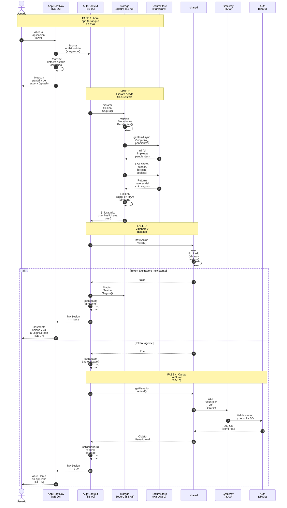

# Flujo de Persistencia y Restauración de Sesión (Especificación Técnica Detallada)

Este documento detalla con **máxima precisión técnica** el recorrido completo de la **persistencia y restauración (hidratación) de sesión** en la aplicación móvil:
`Tokens se guardan en almacenamiento seguro` ➔ `Cierre/Reinicio de la App` ➔ `Al abrir la App se hidrata la sesión` ➔ `Validación de vigencia con desfase` ➔ `Consulta del perfil real` ➔ `Navegación conmuta a acceso privado o público`.

---

## 🗺️ Mapa de Trazabilidad por Historias / Tareas

| Código | Tarea / Componente | Responsabilidad en este flujo |
|---|---|---|
| **SE-08** | Almacenamiento Seguro Móvil | `storageSeguro.ts`: persistencia en `expo-secure-store`, montaje en `cacheMemoria`, marca durable `limpieza_pendiente` y compensación de reloj. |
| **SE-09** | Contexto de Autenticación | `AuthContext.tsx`: estado inicial `'cargando'`, coordinación del hook de arranque (`useEffect`), validación con `haySesionValida()`. |
| **SE-10** | Consulta de Perfil Real | `cargarPerfil()` invoca `getUsuarioActual()`: tolera caídas de red transitorias y desloguea solo si el backend responde 401/404. |
| **SE-06** | Navegación Condicional | `RootNavigator.tsx`: muestra pantalla de carga (*splash*) mientras `estado === 'cargando'`; conmuta a `AppTabNavigator` o `AuthNavigator`. |
| **SE-07** | Pantalla Pública de Retorno | `LoginScreen.tsx`: pantalla a la que el usuario es dirigido si el token expiró o la sesión fue invalidada. |

---

## 🧭 Resumen de Funciones Relevantes y Puntos de Entrada de Datos

| Etapa | Archivo / Capa | Función / Componente Relevante | Dónde y qué datos recibe | Qué hace / Por qué es relevante |
| :--- | :--- | :--- | :--- | :--- |
| **1. Guardado** | `storageSeguro.ts` | `guardarTokensSeguros(tokens)` | Recibe `{ access_token, refresh_token }`. | Persiste en chip seguro (`SecureStore`) y calcula `desfase_reloj_ms` en RAM. |
| **2. Splash** | `RootNavigator.tsx` | `<RootNavigator />` | Lee `estado` desde `useAuth()`. | Si `estado === 'cargando'`, congela la UI con un `<ActivityIndicator>` para evitar parpadeos visuales (*FOUC*). |
| **3. Bootstrap** | `AuthContext.tsx` | `useEffect(() => { verificarSesionInicial() })` | Se ejecuta al montar el proveedor en `App.tsx`. | Dispara la hidratación asíncrona y valida la vigencia antes de pintar cualquier pantalla. |
| **4. Hidratar** | `storageSeguro.ts` | `hidratarSesionSegura()` | Lee del hardware con `getItemAsync`. | Espera mutaciones pendientes, verifica marcas durables y llena `cacheMemoria` síncrono. |
| **5. Vigencia** | `shared/src/auth.ts` | `haySesionValida()` | Lee `access_token` y `desfase_reloj_ms` de RAM. | Comprueba expiración sumando el desfase: `!tokenExpirado(token, ahora + desfase)`. |
| **6. Perfil** | `AuthContext.tsx` | `cargarPerfil(idSesion)` | Recibe `idSesion: number` (generación). | Pide datos reales con `getUsuarioActual()`. Si falla por red (sin internet), mantiene la sesión abierta. |
| **7. Ruteo** | `RootNavigator.tsx` | Render condicional en `<Stack.Navigator>` | Lee `haySesion: boolean`. | Si es `true`, monta `AppTabNavigator`; si es `false`, monta `AuthNavigator`. |

---

## 🔄 Diagrama de Secuencia



---

## 💡 Fichas Rápidas: ¿Qué hace cada función en palabras simples?

Esta sección explica de forma directa y cotidiana qué hace cada función de este flujo, sin rodeos ni lenguaje críptico:

### 1. `<RootNavigator />` (El guardia de la puerta / Pantalla de Espera)
* **Dónde está:** `frontend/movil/src/navigation/RootNavigator.tsx`
* **Qué hace en simple:** Apenas abres la aplicación, congela la pantalla mostrando una ruedita de carga ("Iniciando aplicación…"). Así evita que veas la pantalla de Login por error mientras el celular comprueba si tenías tu sesión guardada.
* **📥 ¿Qué recibe?:** Lee la variable `estado` del contexto de la app (`'cargando'`, `'autenticado'` o `'anonimo'`).
* **📤 ¿Qué entrega?:** Si la app está cargando, dibuja el spinner. Cuando termina, decide si te abre la pantalla privada (`Home`) o la pública (`Login`).
* **🎯 Por qué importa:** Elimina el molesto parpadeo (*glitch*) en el que la app te muestra el formulario de inicio de sesión durante un segundo antes de recordar quién eres.

---

### 2. `verificarSesionInicial()` (El despertador de la sesión al abrir la app)
* **Dónde está:** `frontend/movil/context/AuthContext.tsx`
* **Qué hace en simple:** Es la primera función que se ejecuta al encender la app. Ordena buscar los tokens en el chip del celular y revisa: "¿siguen vigentes?". Si están vivos, te deja pasar a tu cuenta; si ya vencieron, borra los residuos y te manda al Login.
* **📥 ¿Qué recibe?:** Se ejecuta automáticamente al arrancar la aplicación (`useEffect`).
* **📤 ¿Qué envía y a dónde?:** Llama a `hidratarSesionSegura()` para leer el chip, luego consulta a `haySesionValida()` y finalmente dispara `cargarPerfil()` si todo está en orden.
* **🎯 Por qué importa:** Sin esta función, cada vez que cerraras la app tendrías que volver a escribir tu correo y contraseña manualmente.

---

### 3. `hidratarSesionSegura()` (El camión de mudanza del chip a la memoria rápida)
* **Dónde está:** `frontend/movil/src/services/storageSeguro.ts`
* **Qué hace en simple:** Va a la caja fuerte del teléfono (`SecureStore`), lee los tokens guardados y los copia a la memoria RAM. Así, el resto de la app puede leerlos al instante en microsegundos sin hacer esperar al usuario.
* **📥 ¿Qué recibe?:** Lee del chip seguro del dispositivo las claves `access_token`, `refresh_token` y `desfase_reloj_ms`.
* **📤 ¿Qué entrega?:** Llena el diccionario rápido en memoria (`cacheMemoria`) y devuelve `{ hidratado: true, hayTokens: true }`.
* **🎯 Por qué importa:** Leer del chip físico del celular es una operación lenta; copiar los datos a la memoria RAM hace que la app se sienta instantánea y fluida.

---

### 4. `esperarMutacionesPendientes()` (El semáforo de la caja fuerte)
* **Dónde está:** `frontend/movil/src/services/storageSeguro.ts`
* **Qué hace en simple:** Revisa si había algún guardado o borrado a medio camino antes de intentar leer. Si había una tarea pendiente, espera a que termine para no leer datos partidos o inconsistentes.
* **📥 ¿Qué recibe?:** Revisa la lista de promesas en cola del almacenamiento.
* **📤 ¿Qué entrega?:** Una promesa que se libera únicamente cuando el chip del teléfono terminó de escribir todo lo anterior.
* **🎯 Por qué importa:** Evita que la app lea una credencial rota mientras el sistema operativo todavía la estaba escribiendo en el disco.

---

### 5. `haySesionValida()` (El inspector de vigencia con compensación de hora)
* **Dónde está:** `frontend/shared/src/auth.ts`
* **Qué hace en simple:** Toma el token de acceso de la memoria y calcula matemáticamente si ya expiró o si todavía le quedan minutos de vida, teniendo en cuenta si el reloj de tu teléfono tiene la hora mal configurada.
* **📥 ¿Qué recibe?:** Lee el `access_token` y la diferencia horaria (`desfase_reloj_ms`) de la memoria.
* **📤 ¿Qué entrega?:** Devuelve un simple `true` (la sesión sigue viva) o `false` (la sesión ya caducó).
* **🎯 Por qué importa:** Impide que la app envíe peticiones condenadas al fracaso con credenciales vencidas.

---

### 6. `tokenExpirado(token, ahoraMs)` (El comparador matemático de tiempo)
* **Dónde está:** `frontend/shared/src/auth.ts`
* **Qué hace en simple:** Abre el token, extrae el número que dice a qué hora caduca (`exp`) y lo compara numéricamente contra la hora actual corregida (`ahoraMs`).
* **📥 ¿Qué recibe?:** El texto del token y el timestamp actual ajustado en milisegundos.
* **📤 ¿Qué entrega?:** `true` si la hora de vencimiento ya quedó en el pasado, o `false` si todavía es válido.
* **🎯 Por qué importa:** Es la fórmula matemática exacta que decide el destino de la sesión.

---

### 7. `cargarPerfil(idSesion)` (El cartero del perfil de usuario)
* **Dónde está:** `frontend/movil/context/AuthContext.tsx`
* **Qué hace en simple:** Viaja por internet al servidor para buscar tu nombre, correo, plan y rol reales. Si estás sin señal (en el metro o sin internet), no te echa de la app: conserva tu sesión y guarda un aviso de "error de red" para reintentar después.
* **📥 ¿Qué recibe?:** El número de sesión actual (`idSesion`), para evitar responder tarde a sesiones anteriores.
* **📤 ¿Qué envía y a dónde?:** Llama a `getUsuarioActual()` hacia el Gateway, recibe tus datos y actualiza la variable `usuario` en la app.
* **🎯 Por qué importa:** Muestra tus datos reales sin inventar roles falsos y te protege de perder tu sesión si se corta el Wi-Fi momentáneamente.

---

### 8. `getUsuarioActual()` (La llamada HTTP protegida al servidor)
* **Dónde está:** `frontend/shared/src/api/recursos.ts`
* **Qué hace en simple:** Prepara el paquete `GET /api/usuarios/yo/`, le añade tu token de acceso en la cabecera `Authorization: Bearer <token>` y se lo envía al servidor.
* **📥 ¿Qué recibe?:** Toma el token de acceso activo desde la memoria RAM.
* **📤 ¿Qué entrega?:** El objeto de respuesta con los datos del usuario (`{ id, nombre, correo, rol, plan }`).
* **🎯 Por qué importa:** Es el puente de comunicación seguro entre el teléfono y el backend para consultar tus datos personales.

---

### 9. `limpiarSesionSegura()` (El triturador de basura de emergencia)
* **Dónde está:** `frontend/movil/src/services/storageSeguro.ts`
* **Qué hace en simple:** Si la app descubre que tu token estaba vencido o corrupto al abrir la app, esta función destruye todo: limpia la memoria RAM y elimina del chip del teléfono las claves para no dejar datos huérfanos.
* **📥 ¿Qué recibe?:** No recibe parámetros.
* **📤 ¿Qué entrega?:** Vacía `cacheMemoria` y borra en el chip seguro `access_token`, `refresh_token` y `desfase_reloj_ms`.
* **🎯 Por qué importa:** Asegura que una sesión caducada no quede ocupando espacio ni cause comportamientos extraños en futuros arranques.

---

## 🔎 Recorrido Detallado Paso a Paso con Código Relevante

---

### Paso 1: Estado Inicial y Bloqueo de UI (*Splash Screen*)
* **Archivo:** [`frontend/movil/src/navigation/RootNavigator.tsx`](file:///home/sebamena/Documentos/GitHub/integra-lll/frontend/movil/src/navigation/RootNavigator.tsx)
* **Componente clave:** `<RootNavigator />` (líneas 11–21).

#### 💡 ¿Qué hace en simples palabras?
Apenas abres la aplicación, pone una pantalla limpia con una ruedita girando ("Iniciando aplicación…"). Así congela la interfaz y evita que veas parpadear el formulario de Login por medio segundo mientras el teléfono lee las claves guardadas en el chip de memoria.

#### ¿Dónde se reciben los datos?
Al montarse la app, `AuthContext` inicia con:
- `estado: 'cargando'`
- `usuario: null`
- `haySesion: false`

`RootNavigator` lee este valor a través de `useAuth()`.

#### Código Relevante:
```tsx
// frontend/movil/src/navigation/RootNavigator.tsx (Líneas 11-21)
export function RootNavigator() {
  const { estado, haySesion } = useAuth();

  // Mientras el hardware lee las claves, bloquea la navegación
  if (estado === 'cargando') {
    return (
      <View style={styles.loadingContainer} testID="splash-loading">
        <ActivityIndicator size="large" color="#0f172a" />
        <Text style={styles.loadingText}>Iniciando aplicación…</Text>
      </View>
    );
  }
  ...
}
```
> **Por qué es relevante:** Previene el clásico defecto de parpadeo (*FOUC* o *flash of unauthenticated content*), donde la app muestra por medio segundo la pantalla de Login antes de darse cuenta de que ya había una sesión guardada.

---

### Paso 2: Disparo de la Hidratación en Arranque
* **Archivo:** [`frontend/movil/context/AuthContext.tsx`](file:///home/sebamena/Documentos/GitHub/integra-lll/frontend/movil/context/AuthContext.tsx)
* **Función clave:** `verificarSesionInicial()` dentro de `useEffect` (líneas 100–133).

#### 💡 ¿Qué hace en simples palabras?
Es la alarma de arranque del sistema. Le ordena al chip seguro del teléfono que cargue las credenciales, revisa si los pases siguen vigentes con la hora corregida y, si todo está bien, cambia la luz de la app a `'autenticado'` y manda a buscar tus datos personales en segundo plano.

#### ¿Dónde se reciben los datos?
No recibe parámetros; se ejecuta automáticamente cuando el componente `<AuthProvider>` se monta en el árbol de React.

#### Código Relevante:
```tsx
// frontend/movil/context/AuthContext.tsx (Líneas 100-133)
useEffect(() => {
  if (initialEstado || initialUsuario) return;

  // 1. Generador de identidad de sesión monótona
  const idSesion = ++sesionVigente.current;

  async function verificarSesionInicial() {
    // 2. Hidratación asíncrona desde SecureStore hacia caché RAM
    await hidratarSesionSegura();

    // Si durante la lectura el contexto cambió, aborta
    if (idSesion !== sesionVigente.current) return;

    // 3. Verificación de vigencia con el desfase recuperado
    if (!haySesionValida()) {
      try {
        await limpiarSesionSegura();
      } catch {}
      if (idSesion === sesionVigente.current) {
        setUsuario(null);
        setEstado('anonimo');
        setEstadoPerfil('inactivo');
      }
      return;
    }

    // 4. Si el token es válido, pasa a autenticado
    if (idSesion === sesionVigente.current) {
      setEstado('autenticado');
    }
    // 5. Carga el perfil del usuario en segundo plano
    await cargarPerfil(idSesion);
  }

  void verificarSesionInicial();
}, [initialEstado, initialUsuario, cargarPerfil]);
```

---

### Paso 3: Lectura Física en el Hardware Seguro (`SecureStore`)
* **Archivo:** [`frontend/movil/src/services/storageSeguro.ts`](file:///home/sebamena/Documentos/GitHub/integra-lll/frontend/movil/src/services/storageSeguro.ts)
* **Función clave:** `hidratarSesionSegura()` (líneas 215–301).

#### 💡 ¿Qué hace en simples palabras?
Va a la caja fuerte del teléfono (`SecureStore`) y revisa primero si hay alguna limpieza que haya quedado a medias de un cierre anterior. Si todo está limpio, saca el `access_token`, el `refresh_token` y la diferencia horaria, y los copia en la memoria rápida (RAM) para que la app los pueda usar en nanosegundos sin demoras.

#### ¿Dónde se reciben los datos?
Lee directamente desde el chip del teléfono usando `backendActual.getItemAsync(key)` (`expo-secure-store`).

#### Código Relevante:
```typescript
// frontend/movil/src/services/storageSeguro.ts (Líneas 215-288)
export async function hidratarSesionSegura(): Promise<{ hidratado: boolean; hayTokens: boolean }> {
  if (!storageInicializado) inicializarStorageSeguro();

  // 1. Espera a que cualquier escritura previa en la cola termine
  await esperarMutacionesPendientes();

  try {
    // 2. Comprobación durable: ¿hubo un logout previo que no terminó de borrar?
    const limpiezaPendiente = await backendActual.getItemAsync(CLAVES_SEGURAS.LIMPIEZA_PENDIENTE);

    if (limpiezaPendiente === '1') {
      // Destruye credenciales residuales y no restaura sesión corrupta
      await Promise.all([
        backendActual.deleteItemAsync(CLAVES_SEGURAS.ACCESS_TOKEN),
        backendActual.deleteItemAsync(CLAVES_SEGURAS.REFRESH_TOKEN),
        backendActual.deleteItemAsync(CLAVES_SEGURAS.DESFASE_RELOJ).catch(() => {}),
      ]);
      cacheMemoria = {};
      storageHidratado = true;
      return { hidratado: true, hayTokens: false };
    }

    // 3. Lectura concurrente de credenciales y desfase
    const [access, refresh, desfase] = await Promise.all([
      backendActual.getItemAsync(CLAVES_SEGURAS.ACCESS_TOKEN),
      backendActual.getItemAsync(CLAVES_SEGURAS.REFRESH_TOKEN),
      backendActual.getItemAsync(CLAVES_SEGURAS.DESFASE_RELOJ),
    ]);

    // Política estricta: ambos tokens deben existir y no ser cadenas vacías
    if (!access || !refresh || access.trim() === '' || refresh.trim() === '') {
      cacheMemoria = {};
      storageHidratado = true;
      return { hidratado: true, hayTokens: false };
    }

    // 4. Montaje en caché RAM para alimentar el contrato síncrono de shared
    cacheMemoria[CLAVES_SEGURAS.ACCESS_TOKEN] = access;
    cacheMemoria[CLAVES_SEGURAS.REFRESH_TOKEN] = refresh;

    if (desfase && desfase.trim() !== '') {
      cacheMemoria[CLAVES_SEGURAS.DESFASE_RELOJ] = desfase;
    }

    storageHidratado = true;
    return { hidratado: true, hayTokens: true };
  } catch (err) {
    // Si el hardware falla al leer, retorna de forma segura sin autenticar
    cacheMemoria = {};
    storageHidratado = true;
    return { hidratado: false, hayTokens: false };
  }
}
```

---

### Paso 4: Validación de Vigencia con Desfase de Reloj
* **Archivo:** [`frontend/shared/src/auth.ts`](file:///home/sebamena/Documentos/GitHub/integra-lll/frontend/shared/src/auth.ts)
* **Funciones clave:** `haySesionValida()` (líneas 265–268) y `tokenExpirado()` (líneas 254–259).

#### 💡 ¿Qué hace en simples palabras?
Calcula matemáticamente si el token de acceso todavía tiene minutos de vida o si ya murió. Si tu celular tiene el reloj adelantado 40 minutos, esta función le resta ese desfase para compararlo contra la hora real del servidor, evitando que te expulse injustamente de la app.

#### ¿Dónde se reciben los datos?
Lee `access_token` y `desfase_reloj_ms` desde `adaptadorStorageSincrono` (que consulta la `cacheMemoria` que llenamos en el Paso 3).

#### Código Relevante:
```typescript
// frontend/shared/src/auth.ts (Líneas 254-268)
export function tokenExpirado(token: string, ahoraMs: number = Date.now()): boolean {
  const payload = decodificarPayloadJwt(token);
  if (!payload) return true;
  if (typeof payload.exp !== "number") return false;
  // Margen de seguridad de 10 segundos para cubrir la latencia de red
  return payload.exp * 1000 <= ahoraMs + MARGEN_EXPIRACION_MS;
}

export function haySesionValida(ahoraMs: number = Date.now()): boolean {
  const token = obtenerAccessToken();
  // Suma el desfase medido en el login (hora servidor - hora teléfono)
  return token !== null && !tokenExpirado(token, ahoraMs + desfaseReloj());
}
```
> **Por qué es relevante:** Si el usuario tiene el reloj del celular 40 minutos adelantado, `desfaseReloj()` devuelve `-2400000 ms`. Al evaluar `ahoraMs + desfase`, la comparación se hace contra la hora real del servidor, evitando desloguear erróneamente al usuario.

---

### Paso 5: Consulta del Perfil Real y Resiliencia de Red (SE-10)
* **Archivo:** [`frontend/movil/context/AuthContext.tsx`](file:///home/sebamena/Documentos/GitHub/integra-lll/frontend/movil/context/AuthContext.tsx)
* **Función clave:** `cargarPerfil(idSesion: number)` (líneas 65–98).

#### 💡 ¿Qué hace en simples palabras?
Viaja por internet con el token al servidor para traer tu nombre, rol y plan reales. Si estás sin señal (en el metro o sin internet), es tolerante: no te expulsa al Login, sino que mantiene tu sesión abierta y anota que hubo un error de conexión para que los datos carguen cuando vuelva la red.

#### ¿Dónde se reciben los datos?
Invoca `getUsuarioActual()` enviando el token recuperado en la cabecera `Authorization: Bearer <access_token>` hacia el Gateway.

#### Código Relevante:
```tsx
// frontend/movil/context/AuthContext.tsx (Líneas 65-98)
const cargarPerfil = useCallback(async (idSesion: number) => {
  const idPeticion = ++ultimaPeticion.current;
  const esVigente = () =>
    idSesion === sesionVigente.current && idPeticion === ultimaPeticion.current;

  setEstadoPerfil('cargando');
  setErrorPerfil(null);

  try {
    const u = await getUsuarioActual();
    if (!esVigente()) return;

    setUsuario(u);
    setEstadoPerfil('cargado');
    setErrorPerfil(null);
  } catch (err: unknown) {
    if (!esVigente()) return;

    // Distinción crítica de errores:
    if (err instanceof ErrorDeApi && (err.status === 401 || err.status === 404)) {
      // Caso A: El token fue revocado en backend o el usuario fue eliminado
      void limpiarSesionSegura().catch(() => {});
      setUsuario(null);
      setEstado('anonimo'); // Fuerza salida al Login
      setEstadoPerfil('inactivo');
      return;
    }

    // Caso B: Error transitorio (sin conexión a internet o servidor caído)
    // EL USUARIO SIGUE AUTENTICADO: no se destruye la sesión por falta de red
    setUsuario(null);
    setEstadoPerfil('error');
    setErrorPerfil(err instanceof Error ? err.message : 'Error al cargar perfil');
  }
}, []);
```
> **Por qué es relevante:** Si el usuario abre la app en el metro o sin internet, **no se le cierra la sesión**. La app reconoce que tiene credenciales válidas en el chip y lo mantiene dentro, mostrando un estado de reconexión en lugar de patearlo al Login.

---

### Paso 6: Conmutación Atómica de Navegación (SE-06)
* **Archivo:** [`frontend/movil/src/navigation/RootNavigator.tsx`](file:///home/sebamena/Documentos/GitHub/integra-lll/frontend/movil/src/navigation/RootNavigator.tsx)
* **Componente clave:** `<RootNavigator />` (líneas 23–31).

#### 💡 ¿Qué hace en simples palabras?
Quita la pantalla de espera de la ruedita y decide qué mostrarte: si el token estaba vivo, entra directo a la pantalla principal (**Home**) sin pedirte usuario ni clave; si el token ya había expirado, te lleva a la pantalla de **Login** para que inicies sesión.

#### ¿Dónde se reciben los datos?
El hook `useAuth()` notifica que `estado` cambió de `'cargando'` a `'autenticado'` (o `'anonimo'`).

#### Código Relevante:
```tsx
// frontend/movil/src/navigation/RootNavigator.tsx (Líneas 23-31)
return (
  <Stack.Navigator screenOptions={{ headerShown: false }}>
    {!haySesion ? (
      // CASO ANÓNIMO: Token vencido o inexistente -> Muestra Login
      <Stack.Screen name="Auth" component={AuthNavigator} />
    ) : (
      // CASO AUTENTICADO: Token válido hidratado -> Muestra Tabs Privados
      <Stack.Screen name="App" component={AppTabNavigator} />
    )}
  </Stack.Navigator>
);
```

#### Resultado en la experiencia del usuario:
* **Si la sesión era válida:** El spinner desaparece y la app entra directamente al **Home** mostrando sus suscripciones, sin pedir contraseña de nuevo.
* **Si el token había expirado (> 30 min sin refresh):** El spinner desaparece y la app muestra limpiamente el **LoginScreen** listo para ingresar.
